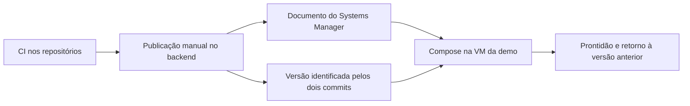

# CI/CD do Hemovia na AWS Design

**Spec**: `.specs/features/cicd-aws-demo/spec.md`
**Status**: Approved approach

## Architecture Overview

A esteira reutiliza o Dockerfile e a compilação Vite. Um pacote em S3 facilita a identificação e recuperação do par de versões. Um registro ECR dedicado resolveria a imagem da API, mas ainda exigiria um meio de entregar o frontend estático. A opção S3 mantém ambos os artefatos no mesmo pacote e evita configurar outro registro na VM.

## Code Reuse Analysis

| Componente | Uso |
| --- | --- |
| `hemovia-backend/.github/workflows/ci-cd.yml` | Preserva testes Maven e publicação de imagem do backend no GHCR. |
| `hemovia-frontend/package.json` e lockfile | CI e build estático com npm. |
| `hemovia-backend/deploy/lightsail` e `docker-compose.yml` | Preserva o projeto Compose, portas, Caddy, Grafana e volumes usados na demo atual. |

## Components

| Componente | Contrato |
| --- | --- |
| CI | Executa em pushes e pull requests nas branches previstas no escopo. |
| Workflows manuais | A `main` do backend publica ou recupera uma versão. Os resultados do SSM aparecem no GitHub. |
| CloudFormation | Cria bucket privado, duas funções de finalidade distinta, provedor OIDC e documento SSM. |
| VM existente | O documento executa o script instalado pelo operador, com parâmetros limitados a operações e identificadores de versão. O script serializa alterações e mantém o estado da última publicação aprovada. |

## Error Handling Strategy

| Situação | Tratamento |
| --- | --- |
| Arquivo ausente, inválido ou indisponível | Registrar falha antes de mudar o Compose. |
| Contêiner ou endpoint deixa de responder | Reaplicar a última versão aprovada quando disponível e retornar falha ao GitHub. |
| Publicação e rollback chegam juntos | Um bloqueio na VM serializa as operações. |

## Risks & Concerns

| Risco | Mitigação |
| --- | --- |
| Os dois repositórios são públicos | Runner hospedado no GitHub. Confiança OIDC restrita à identidade imutável da `main` do backend. |
| Uma publicação pode recriar contêineres em uso | Preservar projeto, `.env` da VM e volumes nomeados. Testar saúde antes de registrar a versão. |
| Migrações novas podem afetar uma imagem antiga | O rollback é da aplicação. A revisão de uma migração deve considerar compatibilidade com a imagem anterior. |
| A demo já contém dados fictícios e configurações do Grafana | Registrar a versão atual como referência de recuperação, mantendo os volumes ativos. |

## Tech Decisions

| Decisão | Escolha |
| --- | --- |
| Identidade da publicação | SHA do backend e SHA do frontend empacotados. |
| Entrada de deploy no host | Documento SSM específico da demo, acionado por OIDC. |
| Dependência do Render | Os workflows, o Blueprint e o guia passam a refletir o destino AWS. |
